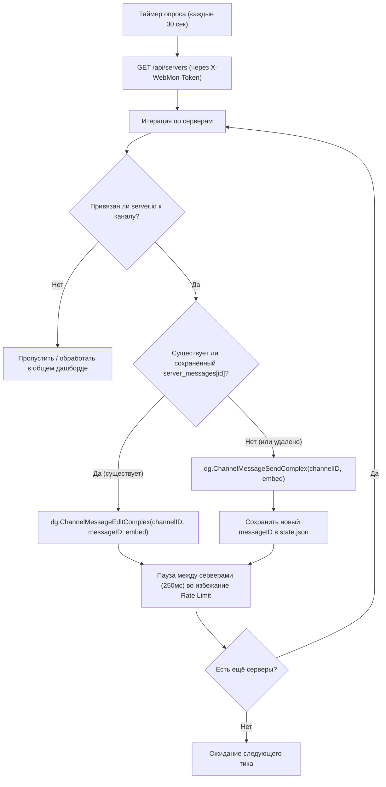

# 📋 Спецификация: Индивидуальные карточки серверов и маршрутизация по каналам (Single Server Card Routing)

> **Статус документа:** Зафиксированный архитектурный план на будущее развитие бота (`GameAP_WebMonBot`).  
> **Сборка бинарников и повышение версий не требуются.**

---

## 1. Концепция и проблематика

### Текущее состояние
В текущей реализации бот группирует серверы по играм (`RenderGameGroupEmbed` / `group_by_game: true`) и отправляет общий список в единый информационный канал (`dashboard_channel_id`):
- Заголовок: категория игры (например, `🟢 Counter-Strike 2 (Онлайн: 3/3)`).
- Тело сообщения: сплошной список серверов в полях `embed.Fields`.

### Целевое состояние
Администраторы игровых проектов часто хотят организовать структуру Discord-сервера с **персональным каналом под каждый игровой сервер**:
```text
📁 ИГРОВЫЕ СЕРВЕРЫ (Категория Discord)
├── 💬 #cs2-mirage          ➔ Индивидуальная живая карточка CS2 Mirage (ID: 1)
├── 💬 #cs2-retake          ➔ Индивидуальная живая карточка CS2 Retake (ID: 2)
├── 💬 #rust-main-x5        ➔ Индивидуальная живая карточка Rust Main (ID: 3)
└── 💬 #minecraft-vanilla   ➔ Индивидуальная живая карточка Minecraft (ID: 4)
```

Каждая карточка — это полноценный, эстетичный, самодостаточный Discord Embed с кнопками быстрого подключения, ссылкой на мониторинг и логотипом игры.

---

## 2. Идентификация серверов: Системный ID vs Ручное назначение

### Анализ вариантов
1. **Нативный системный ID GameAP (`server.id: uint64`) — (РЕКОМЕНДОВАНО И ПРИНЯТО):**
   - В GameAP каждый сервер при создании получает первичный числовой ключ в базе данных (`id = 1, 2, 3...`).
   - Он **никогда не изменяется**, гарантированно уникален и уже передаётся в DTO плагина WebMonitoring (`PublicServerDTO.ID`).
   - **Плюсы:** Нулевая необходимость ручного заведения ID. Никаких рассинхронизаций между панелью и ботом.
2. **Пользовательский псевдоним (Slug / Alias):**
   - Возможность задать текстовый ярлык (например, `"mirage"` или `"rust-1"`).
   - Может поддерживаться опционально как алиас, но внутренним ключом всегда остаётся `server.id`.

---

## 3. Дизайн персональной карточки сервера (Single Server Embed)

### Требования к дизайну:
1. **Исключение сетевого пинга:** Пинг (`18ms`) исключён из макета карточки, так как пинг до сервера зависит от интернет-провайдера каждого игрока и создаёт лишний информационный шум.
2. **Исключение превью карты:** Хранение и синхронизация сотен картинок игровых карт (`de_mirage`, `de_dust2`, `rust_island`, кастомных карт) сложна и нестабильна.
3. **Каталог логотипов/иконок игр:** Вместо превью карты в верхнем правом углу карточки (`thumbnail.url`) размещается официальная качественная иконка/логотип игры из проверенного каталога.

### 🎨 Визуальный макет карточки в Discord

```text
┌────────────────────────────────────────────────────────────────────────┐
│ ▌ 🎮 ★ CyberZone CS2 | Mirage 24/7 [128 Tick]       ┌───────────────┐ │
│ ▌ Консоль: `connect 198.51.100.10:27015`            │  [Логотип     │ │
│ ▌                                                   │   игры CS2]   │ │
│ ▌ Статус              Адрес и порт          Локация │  (Thumbnail)  │ │
│ ▌ 🟢 В сети           `198.51.100.10:27015` 🇩🇪 DE   └───────────────┘ │
│ ▌                                                                     │
│ ▌ Игра                Текущая карта         Игроки                    │
│ ▌ Counter-Strike 2    Mirage (de_mirage)    18/32 [██████░░░░]        │
│ ▌                                                                     │
│ ▌ 🌐 GameAP WebMonitoring • Обновлено <t:TIMESTAMP:R>                 │
└────────────────────────────────────────────────────────────────────────┘
  [ 🎮 Подключиться ]   [ 🔄 Обновить ]
```

### 📋 Структура Embed в Discord API:
- **Title:** `server.Name` (например, `🎮 ★ CyberZone CS2 | Mirage 24/7`).
- **Description:** `Консоль: connect <address>:<port>` (моноширинный блок для быстрого копирования).
- **Color:**
  - Зелёный `#2ecc71` (Online).
  - Красный `#e74c3c` (Offline).
- **Thumbnail:** URL логотипа игры из каталога (см. раздел 4).
- **Fields (Сетка 2x3, все `inline: true`):**
  1. `Статус`: `🟢 В сети` / `🔴 Недоступен`
  2. `Адрес и порт`: `` `<address>:<port>` ``
  3. `Локация / Движок`: `🇩🇪 DE` (или `Valve Source` / мод игры)
  4. `Игра`: `server.GameName` (например, `Counter-Strike 2`)
  5. `Текущая карта`: `server.Map` (или `—`, если оффлайн)
  6. `Игроки`: `<players>/<max_players> [██████░░░░]`
- **Footer:** `🌐 GameAP WebMonitoring • Обновлено <t:UNIX:R>`
- **Components (ActionRow):**
  - Кнопка 1 (`CustomID: "connect:<server_id>"`): `🎮 Подключиться` (вызывает всплывающее эфемерное окно с инструкцией).
  - Кнопка 2 (`CustomID: "refresh:<server_id>"`): `🔄 Обновить` (точечное обновление именно этой карточки).

---

## 4. Каталог иконок игр (Game Icons Catalog)

Для отображения красивого Thumbnail логотипа игры в правом верхнем углу используется централизованный каталог по `game_code` (или `game_id`):

| Игра | `game_code` в GameAP | Steam AppID | URL официальной иконки (CDN) |
| :--- | :--- | :---: | :--- |
| **Counter-Strike 2** | `cs2` | 730 | `https://cdn.cloudflare.steamstatic.com/steam/apps/730/header.jpg` |
| **Counter-Strike 1.6** | `cstrike` | 10 | `https://cdn.cloudflare.steamstatic.com/steam/apps/10/header.jpg` |
| **Team Fortress 2** | `tf2` | 440 | `https://cdn.cloudflare.steamstatic.com/steam/apps/440/header.jpg` |
| **Rust** | `rust` | 252490 | `https://cdn.cloudflare.steamstatic.com/steam/apps/252490/header.jpg` |
| **Garry's Mod** | `gmod` | 4000 | `https://cdn.cloudflare.steamstatic.com/steam/apps/4000/header.jpg` |
| **Left 4 Dead 2** | `left4dead2` | 550 | `https://cdn.cloudflare.steamstatic.com/steam/apps/550/header.jpg` |
| **Valheim** | `valheim` | 892970 | `https://cdn.cloudflare.steamstatic.com/steam/apps/892970/header.jpg` |
| **7 Days to Die** | `sdtd` | 251570 | `https://cdn.cloudflare.steamstatic.com/steam/apps/251570/header.jpg` |
| **DayZ** | `dayz` | 221100 | `https://cdn.cloudflare.steamstatic.com/steam/apps/221100/header.jpg` |
| **Minecraft** | `minecraft` | — | `https://raw.githubusercontent.com/br1ckzzz/gameap_monitoring_plugin/main/docs/images/games/minecraft.png` |
| **SA-MP / GTA** | `samp` | — | `https://raw.githubusercontent.com/br1ckzzz/gameap_monitoring_plugin/main/docs/images/games/samp.png` |
| **Fallback (По умолчанию)** | `default` | — | `https://raw.githubusercontent.com/br1ckzzz/gameap_monitoring_plugin/main/icon.png` |

> [!TIP]
> В коде Go-бота создаётся хелпер `GetGameIconURL(gameCode string) string`:
> Он проверяет `map[string]string` сопоставления. Если игра отсутствует в списке, возвращается брендовая иконка GameAP WebMonitoring.

---

## 5. Архитектура маршрутизации каналов в `GameAP_WebMonBot`

### 5.1 Конфигурация (`config.json`)
В секцию `discord` добавляется сопоставление ID серверов GameAP и ID каналов Discord:

```json
{
  "discord": {
    "guild_id": "123456789012345678",
    "dashboard_channel_id": "",
    "server_channels": {
      "1": "100100100100100101",
      "2": "100100100100100102",
      "3": "100100100100100103"
    }
  }
}
```

### 5.2 Хранение состояния сообщений (`state.json`)
Бот сохраняет созданные ID сообщений под каждый сервер, чтобы при последующих итерациях вызывать `PATCH /messages/{id}`:

```json
{
  "guild_id": "123456789012345678",
  "server_channels": {
    "1": "100100100100100101",
    "2": "100100100100100102"
  },
  "server_messages": {
    "1": "200200200200200201",
    "2": "200200200200200202"
  },
  "last_updated": "2026-09-27T14:40:00Z"
}
```

### 5.3 Слэш-команды в Discord для администратора
Для удобного назначения каналов без ручной правки JSON-файлов:
- `/mon-bind-server server_id: 1 channel: #cs2-mirage`
  - Проверяет доступность сервера с ID=1 в API GameAP.
  - Сохраняет связку в `state.json`.
  - Отправляет первоначальную карточку сервера в указанный канал.
- `/mon-unbind-server server_id: 1`
  - Отвязывает сервер от канала.

---

## 6. Алгоритм цикла синхронизации бота (Update Cycle)



---

## 7. Резюме решений
1. **Идентификаторы:** Используется стабильный `server.id` из GameAP.
2. **Дизайн:** Макет 2x3 с инлайн-кодом консоли, статус-бейдж, прогресс-бар игроков.
3. **Пинг:** Исключён из интерфейса как шум.
4. **Превью карт:** Заменено на официальный каталог логотипов игр по `game_code`.
5. **Каналы:** Полная поддержка привязки 1 сервер = 1 отдельный канал Discord.
